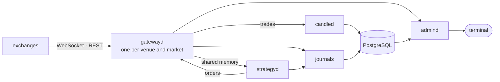

# How raikiri works

This is for people who want to change raikiri, or to know what it does with their orders before
they trust it. Using it needs only the [README](README.md) and the [documentation](docs/README.md).

## The processes

raikiri runs as a few small programs on one machine:

| process | what it does |
| :-- | :-- |
| `gatewayd` | one per exchange and market, such as Binance perpetuals or Deribit options. Holds the venue's connections, turns its messages into raikiri's own records, and sends orders. |
| `strategyd` | runs strategies. One thread, one book across every gateway it reads. |
| `admind` | the HTTP and WebSocket server the terminal and your scripts talk to. |
| `apid` | the client API for programs on other machines, in front of `admind`. |
| `persisterd` | copies every process's journal into PostgreSQL. |
| `candled` | folds every gateway's trades into one-minute candles in PostgreSQL and fills the minutes it missed from each venue's public history. |
| `refd` | optional: one reference price per asset, taken across venues. |

## One process per venue

Exchanges fail on their own schedule, whether a socket drops or an IP gets banned for an hour.
With each venue in its own process, the failure stays there: the gateway's data stops
updating, everyone reading it sees its heartbeat stop, and the other venues carry on. A gateway
can be restarted, rebuilt or replaced without touching the rest.

## Shared memory instead of messages

A gateway writes into a shared-memory segment that it alone owns, and every reader maps that
segment and reads it in place, with no broker, queue or socket between them. A reader with
nothing to do can sleep until the gateway writes again.

Each kind of data gets the channel that suits what losing it would cost:

| data | channel | why |
| :-- | :-- | :-- |
| quotes, depth, funding, greeks, venue positions | table, newest value wins (seqlock) | only the latest value matters, so a slow reader skips ahead |
| trades and order events | broadcast ring that reports gaps | a missed fill would leave the book wrong, so an overrun is reported |
| order commands | one-way ring that never drops (SPSC) | a cancel has to arrive even under load |

## The way an order travels

A strategy asks for an order. The risk gate checks it against notional, price band and open-order
limits, and refuses every new order until a person has declared the desk's capital. The order then
goes down the gateway's command ring; the gateway signs it and sends it over the venue's trade
socket where one exists, or REST otherwise. Acknowledgements and fills come back over the
venue's private stream and the execution ring, and periodic pulls compare positions with what
the venue reports.

Orders bigger than one book can take go through the router in `libs/joe`. It splits the quantity
across venues by price after each venue's taker fee, sends each part as a whole number of lots
that clears the venue's minimum, and limits each part to the deepest price it was planned for,
so a moving book cannot drag it further.

## Money is an integer

Prices and sizes are 64-bit fixed-point integers from the wire to the database. A value from a
venue that is not an exact multiple of the instrument's tick or lot is treated as a format change
and refused, because rounding it would hide the change. "The venue cannot report", "the request
failed" and "the venue reported zero" are three different states, so a failed position read is
never mistaken for a flat position.

## Every process keeps a record

Each process appends what it saw and did to its own journal, a memory-mapped file in a compact
binary format (SBE). `persisterd` copies the journals into PostgreSQL in the background, so trading
never waits on the database, and `replay` decodes a journal back into text.

## Speed

Measured on an Apple M-series laptop with a release build (`make bench`); production runs on
Linux x86-64. The [documentation](docs/README.md#performance) has the full tables.

| operation | time |
| :-- | --: |
| read a quote | 0.68 ns |
| one message between two processes, median | 83 ns |
| round trip between two processes, median | 167 ns |
| round trip, 99.9th percentile | 292 ns |

The hot path allocates no memory once running and reports errors as values. Connection handling,
which is not on the hot path, uses exceptions and coroutines.

## Where things live

| path | contents |
| :-- | :-- |
| `apps/` | the programs above |
| `libs/shm` | shared-memory segments, tables and rings |
| `libs/venues/<name>` | one adapter per exchange |
| `libs/exec` | what each venue supports |
| `libs/oms` | order state and the risk gate |
| `libs/joe` | routing, TWAP and VWAP |
| `libs/candles` | one-minute candles and each venue's history reader |
| `libs/strategy` | the interface strategies implement |
| `frontend/` | the terminal |
