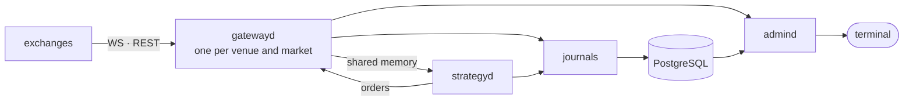

<div align="center">


# raikiri

> 雷切 — "lightning cutter", the sword said to have cut a bolt of lightning.
> raikiri is a low-latency, multi-process crypto trading framework in C++23.

[](RELEASES.md)
[](LICENSE)
[](docs/README.md#performance)
[](CMakeLists.txt)
[](#venues)
[](#venues)
[](docs/README.md#build-and-test)
[](docs/README.md#build-and-test)

[Quick start](#quick-start) · [Write a strategy](#write-a-strategy) · [Terminal](#terminal) ·
[Venues](#venues) · [Documentation](docs/README.md) · [Releases](RELEASES.md) ·
[API contract](schema/admin-api.yaml)

</div>

## Introduction

raikiri connects to crypto exchanges, normalises their market data and order flow, and hands both to
your strategy through shared memory. Each exchange runs in its own gateway process; a single-threaded
kernel holds one book across all of them, so a strategy reads every venue it trades and sends orders
back without a socket, a broker or a lock on the way.

It is written for people who build their own trading systems: the framework handles the parts every
desk rewrites (connections, symbol mapping, rate limits, signing, reconciliation, journals) and stays
out of the decision itself. Strategies are plain C++ classes, and the library is LGPL, so they can
stay closed source.

## Features

- **Fast**: cross-process round trip p50 167 ns over SPSC rings; seqlock reads in under a nanosecond;
  no allocation on the hot path.
- **Many venues**: 43 CEX and DEX venues for market data, 23 with order entry, across spot, perpetuals,
  futures and options.
- **Exact**: money is fixed-point `int64` end to end, and a value off the venue's tick or lot grid is
  refused, never rounded.
- **Isolated**: one process per venue and market; a crashed or banned gateway takes nothing else down.
- **Recorded**: every process writes an append-only SBE journal, copied into PostgreSQL off the
  trading path.
- **Safe with keys**: credentials are references (`env:`, `file:`, `exec:`, `op://`), never values on
  a command line; a risk gate checks every order against notional, band and open-order limits.
- **Execution algos**: `joe` works parent orders across venues as TWAP, VWAP or smart-routed slices.
- **Observable**: an HTTP and WebSocket admin API, Prometheus metrics, and a web terminal on top.

## Terminal

<!-- terminal demo: record a short GIF and save it as .github/assets/terminal.gif, then uncomment
<p align="center">
  
</p>
-->

The web terminal in [`frontend/`](frontend/README.md) runs on the admin API:

- **Markets**: market watch, chart, order book, an order ticket and the blotter.
- **Scanner**: tables from any board service plugged into admind with `--upstream boards=<port>`.
- **Execution**: parent orders worked by `joe`, their child orders, and a ticket to start one.
- **Treasury**: balances, positions and P&L split into realised, fees and funding, by venue and over
  time.
- **Settings**: the accounts admind knows.

`make up` starts gateways, admind and the terminal locally.

## Quick start

CMake ≥ 3.28, Ninja, Conan 2 and a C++23 compiler (GCC 14, Clang 18 or AppleClang 17).

```sh
git clone https://github.com/TeachPenguinsFly/raikiri.git
cd raikiri
make deps && make build
```

Watch a live market; public data needs no keys:

```sh
build/dev-asan/apps/gatewayd/gatewayd --venue=bybit --symbol=BTCUSDT --duration 20
```

Run the whole pipeline against the simulated venue, with a latency table at the end:

```sh
make demo
```

## Write a strategy

A strategy overrides the callbacks it needs and talks to the kernel through `Context`:

```cpp
#include <raikiri/strategy/factory.hpp>
#include <raikiri/strategy/strategy.hpp>

using namespace raikiri;

// rests one lot post-only at the best bid and follows the bid as it moves
class JoinBid final : public strategy::Strategy {
public:
    void on_bbo(strategy::Context& ctx, const Bbo& bbo) override {
        if (bbo.bid.is_undef() || bbo.bid == price_) {
            return;
        }
        if (resting_.valid()) {
            (void)ctx.cancel(resting_);
        }
        const auto id = ctx.submit({.instrument = bbo.instrument,
                                    .side = Side::Buy,
                                    .flags = OrderFlags::PostOnly,
                                    .price = bbo.bid,
                                    .qty = QtyLots::from_raw(1)});
        resting_ = id.value_or(ClientOrderId{});
        price_ = bbo.bid;
    }

private:
    ClientOrderId resting_{};
    PriceTicks price_{};
};

const bool registered = strategy::register_type<JoinBid>("join-bid");
```

```sh
strategyd --gateway=bybit --strategy join-bid
```

Besides `on_bbo` there are `on_trade`, `on_funding`, `on_order_event`, `on_timer`, `on_start` and
`on_stop`. `Context` also gives the strategy its position, unrealised PnL, timers and `set_target`,
which declares the position to hold and lets the kernel send the orders.
[`demo_maker.hpp`](libs/strategies/include/raikiri/strategies/demo_maker.hpp) is a complete two-sided
example.

## Architecture



Each gateway owns a shared-memory segment; the kernel reads all of them, keeps one book and sends
orders back through lossless rings. The [documentation](docs/README.md#architecture) covers the
channels, the invariants the code relies on, running a gateway, configuration and adding a venue.

## Venues

`custody` says who holds the coins: the exchange (CEX) or a contract (DEX). `order entry` is the
transport orders take; *market data only* means the adapter sends none yet. The
[venue table notes](docs/README.md#venue-table) explain every column.

<!-- venues:begin -->
| venue | custody | markets | order entry | WS | FIX | private stream | funding ledger |
| :-- | :-: | :-- | :-- | :-: | :-: | :-- | :-: |
| &nbsp;`apex` | DEX | perp | **market data only** | – | – | – | – |
| &nbsp;`arcus` | DEX | perp | **market data only** | – | – | – | – |
| &nbsp;`aster` | DEX | spot · perp | REST | – | – | ListenKey | ✓ |
| &nbsp;`backpack` | CEX | spot · perp | **market data only** | – | – | – | – |
| &nbsp;`binance` | CEX | spot · perp · options | REST + WS | ✓ | – | ListenKey | ✓ |
| &nbsp;`bingx` | CEX | spot · perp | REST | – | – | ListenKey | ✓ |
| &nbsp;`bitfinex` | CEX | spot · perp | REST | – | – | AuthSubscribe | – |
| &nbsp;`bitget` | CEX | spot · perp | REST + WS | ✓ | – | AuthSubscribe | ✓ |
| &nbsp;`bithumb` | CEX | spot | **market data only** | – | – | – | – |
| &nbsp;`bitstamp` | CEX | spot · perp | **market data only** | – | – | – | – |
| &nbsp;`bitunix` | CEX | spot · perp | REST | – | – | – | – |
| &nbsp;`blofin` | CEX | perp | REST | – | – | AuthSubscribe | – |
| &nbsp;`bullish` | CEX | spot · perp | **market data only** | – | – | – | – |
| &nbsp;`bybit` | CEX | spot · perp · options | REST + WS | ✓ | – | AuthSubscribe | ✓ |
| &nbsp;`coinbase` | CEX | spot | REST | – | – | AuthSubscribe | – |
| &nbsp;`cryptocom` | CEX | spot · perp | **market data only** | – | – | – | – |
| &nbsp;`deribit` | CEX | spot · perp · futures · options | REST | – | – | AuthSubscribe | ✓ |
| &nbsp;`derive` | DEX | perp · options | **market data only** | – | – | – | – |
| &nbsp;`dydx` | DEX | perp | **market data only** | – | – | – | – |
| &nbsp;`edgex` | DEX | spot · perp | REST | – | – | AuthSubscribe | – |
| &nbsp;`extended` | DEX | perp | **market data only** | – | – | – | – |
| &nbsp;`gate` | CEX | spot · perp · options | REST + WS | ✓ | – | AuthSubscribe | ✓ |
| &nbsp;`grvt` | DEX | perp | **market data only** | – | – | – | – |
| &nbsp;`htx` | CEX | spot · perp | REST | – | – | AuthSubscribe | ✓ |
| &nbsp;`hyperliquid` | DEX | spot · perp | REST + WS | ✓ | – | AuthSubscribe | ✓ |
| &nbsp;`kraken` | CEX | spot · perp | REST | – | – | AuthSubscribe | – |
| &nbsp;`kucoin` | CEX | spot · perp | REST + WS | ✓ | – | ListenKey | ✓ |
| &nbsp;`lbank` | CEX | spot · perp | **market data only**, no perp order API | – | – | – | – |
| &nbsp;`lighter` | DEX | spot · perp | REST + WS | ✓ | – | AuthSubscribe | – |
| &nbsp;`mexc` | CEX | spot · perp | REST | – | – | AuthSubscribe | ✓ |
| &nbsp;`nado` | DEX | perp | **market data only** | – | – | – | – |
| &nbsp;`okx` | CEX | spot · perp · options | REST + WS | ✓ | – | AuthSubscribe | ✓ |
| &nbsp;`ondoperps` | DEX | perp | **market data only** | – | – | – | – |
| &nbsp;`ostium` | DEX | perp | **market data only** | – | – | – | – |
| &nbsp;`pacifica` | DEX | perp | **market data only** | – | – | – | – |
| &nbsp;`paradex` | DEX | perp | **market data only** | – | – | – | – |
| &nbsp;`phemex` | CEX | spot · perp | REST | – | – | AuthSubscribe | – |
| &nbsp;`polymarketperps` | DEX | perp | **market data only** | – | – | – | – |
| &nbsp;`toobit` | CEX | spot · perp | REST | – | – | ListenKey | – |
| &nbsp;`upbit` | CEX | spot | **market data only** | – | – | – | – |
| &nbsp;`vest` | DEX | perp | **market data only** | – | – | – | – |
| &nbsp;`weex` | CEX | spot · perp | REST | – | – | AuthSubscribe | ✓ |
| &nbsp;`xt` | CEX | spot · perp | REST | – | – | ListenKey | ✓ |
<!-- venues:end -->

## Releases

raikiri follows [semantic versioning](https://semver.org). Until 1.0 any minor release may change
the API or a shared-memory layout, and its notes will say so; a gateway and a kernel built with different
shared-memory layouts refuse to attach rather than misread each other. The version lives in [`VERSION`](VERSION),
every binary prints it with `--version`, and [RELEASES.md](RELEASES.md) lists what each release
changed.

The current release is **0.1.0-beta.1**: the first public beta. Market data is in daily use; order
entry is tested against recorded venue replies, and not every order path has run against a real
account yet.

## Disclaimer

raikiri is software for building trading systems, not a trading system. It comes with no warranty,
and trading with it can lose money, fast. Test against the simulated venue and with small size
first; you are responsible for complying with each venue's terms and your local law.

## License

LGPL-3.0, see [`LICENSE`](LICENSE). [`COPYING`](COPYING) holds the GPL-3.0 text it
incorporates by reference. A strategy that links raikiri can stay closed source; a distributed
modification of raikiri itself must publish its changes under the same license.
