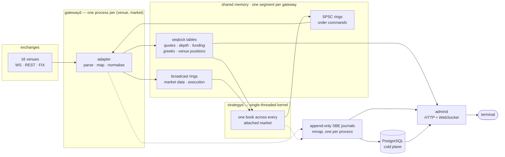

<div align="center">

# raikiri

**A low-latency, multi-process crypto trading framework in C++23**

Sixteen exchange adapters, each its own process, talking over lock-free shared memory.<br>
No message broker on the hot path. No database write in front of an order.

[](LICENSE)
[](CMakeLists.txt)
[](#venues)
[](#venues)
[](#build)
[](#build)

[Venues](#venues) · [Architecture](#architecture) · [Quick start](#quick-start) ·
[Performance](#performance) · [API contract](schema/admin-api.yaml) · [Status](#status)

</div>

---

## Architecture



Each gateway is one process serving **one venue and one market** —
`gatewayd --venue=deribit --market=option` — and owning a shared-memory segment. A
single-threaded kernel busy-polls every segment it is attached to, holds one book
across all of them, and fires orders back through the command rings. `persisterd`
tails the journals into Postgres; the trading path never waits on either.

**The channel class is a decision per channel, not a default.**

| Channel | Kind | Why |
| :-- | :-- | :-- |
| quotes, depth, funding, greeks, venue positions | seqlock table, overwrite-newest | a stale tick is worthless — a reader that falls behind should skip, never queue |
| market data, execution events | broadcast ring, gap-detecting | a fill that was dropped is money the book never learned about; an overrun is reported, not absorbed |
| order commands | SPSC ring, lossless | the escape hatch must work precisely when something is wrong |

<details>
<summary><b>Invariants the code is built on</b></summary>

<br>

- Money is fixed-point `int64` throughout. `double` is banned from decision code — a
  double round-trip is exactly how a price becomes off by a tick.
- A wire value that does not divide exactly by an instrument's tick or lot size is a
  **schema event**, never something to round over.
- Absence of evidence is not evidence of flatness. A venue that cannot report, a pull
  that failed, and a venue reporting zero are three different facts; collapsing them is
  how a system concludes it holds nothing while holding something.
- Hot path: `std::expected`, preallocated, zero allocation in steady state.
  Cold path: exceptions, coroutines for connection orchestration.
- Production target is Linux x86-64. macOS is a supported dev and demo platform, with
  no core pinning or hugepages.

</details>

---

## Build

Requires CMake ≥ 3.28, Ninja, Conan 2, and a C++23 compiler — GCC 14, Clang 18 or
AppleClang 17.

```sh
make deps                  # dependencies via Conan
make test                  # ASan + UBSan
make test PRESET=dev-tsan  # ThreadSanitizer
make bench                 # Release benchmarks
make fuzz FUZZ_SECONDS=60  # libFuzzer targets (Homebrew clang on macOS)
```

---

## License

**LGPL-3.0.** Full text in [`LICENSE`](LICENSE); [`COPYING`](COPYING) holds the GPL-3.0
text that LGPL-3.0 incorporates by reference.

Chosen deliberately over a permissive licence. A strategy or an application that links
raikiri stays closed if its author wants it closed, while a fork of the framework
itself has to publish its changes. LGPL carries no network clause, so running raikiri
as a hosted service triggers no obligation either way.
