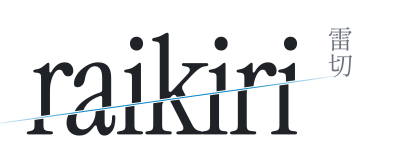
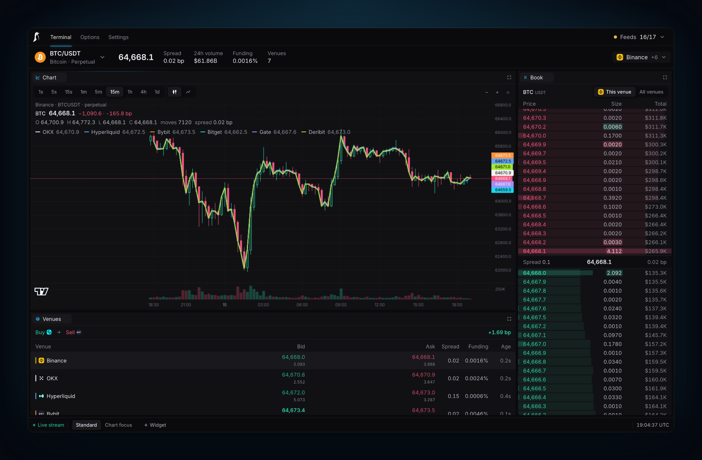
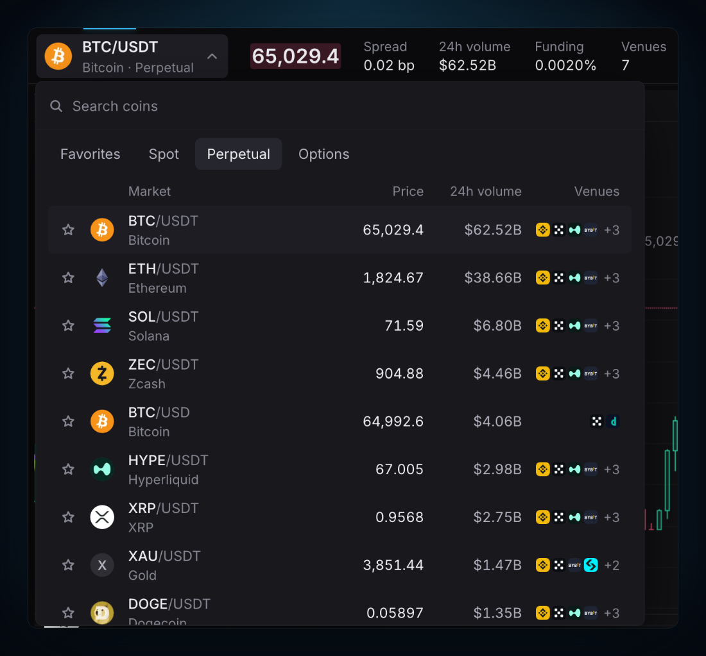
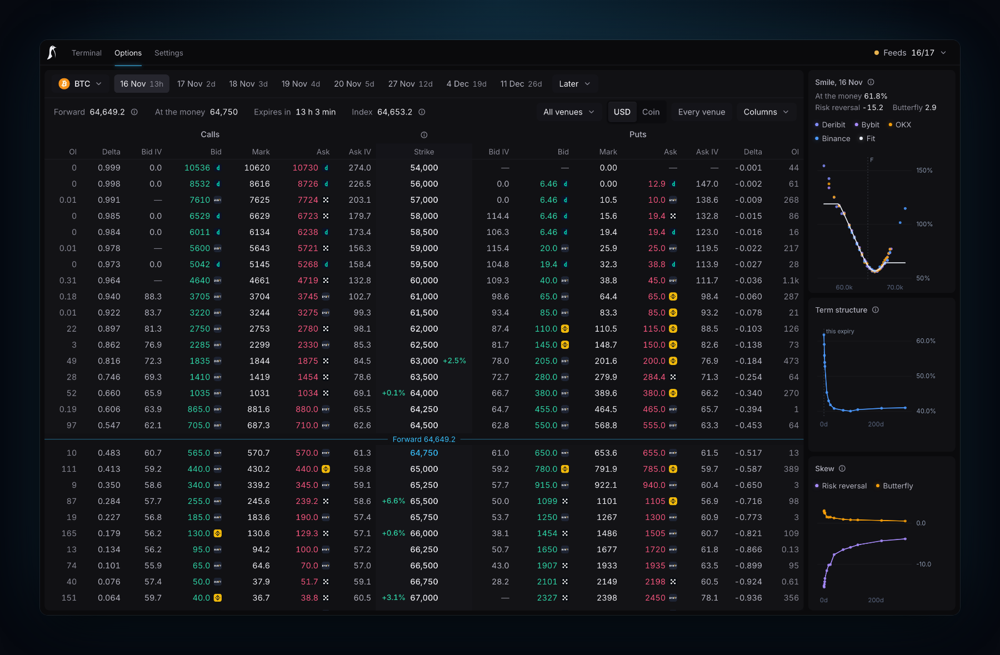
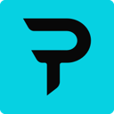

<p align="center">
  <picture>
    <source media="(prefers-color-scheme: dark)" srcset=".github/assets/wordmark-dark.svg">
    
  </picture>
</p>

<p align="center">
  Open-source trading for crypto exchanges, centralised and on-chain.<br>
  Live market data, order execution and a terminal for every venue, in one place.
</p>

<p align="center">
  <a href="LICENSE"></a>
  
  <a href="https://github.com/TeachPenguinsFly/raikiri/actions/workflows/build.yml"></a>
</p>

<p align="center">
  <a href="#quick-start">Quick start</a> ·
  <a href="#venues">Venues</a> ·
  <a href="ARCHITECTURE.md">How it works</a> ·
  <a href="docs/README.md">Documentation</a>
</p>

<p align="center">
  
</p>

Most trading desks build the same plumbing before they can test an idea: exchange connections,
symbol mapping, rate limits, order signing, bookkeeping. raikiri ships all of it, so you write only
the strategy. A strategy is a plain C++ class, and it can stay closed source.

## Features

### All venues on one screen

The terminal draws every venue's price for a market on one chart and lists their quotes side by
side, so you can see where a coin is cheaper. Beside them, the order book shows one venue's depth
or all of them merged.

### Every market in one list

Hover the market's name and every market opens, in spot, perpetual and options tabs, each coin
with its name and icon. Coins listed on several venues come first, then the rest by 24-hour
volume, so thin look-alike tickers end up at the bottom.

<p align="center">
  
</p>

### Charts with history

`candled` folds every trade the gateways see into one-minute candles in PostgreSQL. Whatever it
missed, it fetches from each venue's public history, so a chart opens with days of bars, from one
minute to one day.

### Options from six exchanges

The options desk merges the chains of Deribit, OKX, Bybit, Binance, Gate and Derive, and shows
the volatility smile and term structure beside them.

<p align="center">
  
</p>

### Smart order routing

A strategy can hand a large order to the router, which splits it across venues by price after
fees. No part of it goes deeper into a book than planned. TWAP and VWAP are there too.

<p align="center">
  
</p>

### Very fast

A price reaches your strategy in under a microsecond (gateways and strategies run on one machine
and share memory, so nothing goes over a network).

### Safe by default

Every order passes a risk check, and API keys never appear on a command line. Each venue gets a
request budget below its rate limit, so you don't get banned.

### Open to your own tools

Programs on other machines trade through the Python and C++ SDKs. There is also a web API with an
OpenAPI spec, and Prometheus metrics.

## Quick start

```sh
git clone https://github.com/TeachPenguinsFly/raikiri.git
cd raikiri
make deps && make build
make up
```

The terminal opens at <http://127.0.0.1:5173>. Market data needs no API keys. You need CMake,
Ninja, Conan 2 and a C++23 compiler. To keep chart history, run `make dup` instead, which also
starts PostgreSQL in Docker, and `make web` beside it for the terminal.

## Venues

<!-- venues:begin -->
43 venues. Spot markets on 29, perpetual futures (perp) on 40, dated futures on 1 and options on 6.

### Trading and market data

<table>
<tr><td align="center" width="140"><br><b>ApeX</b><br></td><td align="center" width="140"><br><b>Aster</b><br> </td><td align="center" width="140"><br><b>Binance</b><br>  </td><td align="center" width="140"><br><b>BingX</b><br> </td><td align="center" width="140"><br><b>Bitfinex</b><br> </td><td align="center" width="140"><br><b>Bitget</b><br> </td></tr>
<tr><td align="center" width="140"><br><b>Bitunix</b><br> </td><td align="center" width="140"><br><b>BloFin</b><br></td><td align="center" width="140"><br><b>Bybit</b><br>  </td><td align="center" width="140"><br><b>Coinbase</b><br></td><td align="center" width="140"><br><b>Deribit</b><br>   </td><td align="center" width="140"><br><b>edgeX</b><br> </td></tr>
<tr><td align="center" width="140"><br><b>Gate</b><br>  </td><td align="center" width="140"><br><b>HTX</b><br> </td><td align="center" width="140"><br><b>Hyperliquid</b><br> </td><td align="center" width="140"><br><b>Kraken</b><br> </td><td align="center" width="140"><br><b>KuCoin</b><br> </td><td align="center" width="140"><br><b>Lighter</b><br> </td></tr>
<tr><td align="center" width="140"><br><b>MEXC</b><br> </td><td align="center" width="140"><br><b>OKX</b><br>  </td><td align="center" width="140"><br><b>Phemex</b><br> </td><td align="center" width="140"><br><b>Toobit</b><br> </td><td align="center" width="140"><br><b>WEEX</b><br> </td><td align="center" width="140"><br><b>XT</b><br> </td></tr>
</table>

### Market data only

<table>
<tr><td align="center" width="140"><br><b>Arcus</b><br></td><td align="center" width="140"><br><b>Backpack</b><br> </td><td align="center" width="140"><br><b>Bithumb</b><br></td><td align="center" width="140"><br><b>Bitstamp</b><br> </td><td align="center" width="140"><br><b>Bullish</b><br> </td><td align="center" width="140"><br><b>Crypto.com</b><br> </td></tr>
<tr><td align="center" width="140"><br><b>Derive</b><br> </td><td align="center" width="140"><br><b>dYdX</b><br></td><td align="center" width="140"><br><b>Extended</b><br></td><td align="center" width="140"><br><b>GRVT</b><br></td><td align="center" width="140"><br><b>LBank</b><br> </td><td align="center" width="140"><br><b>Nado</b><br></td></tr>
<tr><td align="center" width="140"><br><b>Ondo</b><br></td><td align="center" width="140"><br><b>Ostium</b><br></td><td align="center" width="140"><br><b>Pacifica</b><br></td><td align="center" width="140"><br><b>Paradex</b><br></td><td align="center" width="140"><br><b>Polymarket</b><br></td><td align="center" width="140"><br><b>Upbit</b><br></td></tr>
<tr><td align="center" width="140"><br><b>Vest</b><br></td></tr>
</table>
<!-- venues:end -->

[Everything each venue supports](docs/README.md#venue-table)

## Learn more

- [How it works](ARCHITECTURE.md): processes, shared memory, the order path, speed
- [Documentation](docs/README.md): writing a strategy, the client API, running gateways, configuration, adding a venue
- [Client SDKs](sdk/python/README.md): Python and C++, with [examples](examples/README.md)

## License

LGPL-3.0, see [`LICENSE`](LICENSE). Your strategy can link raikiri and stay closed source. If you
distribute changes to raikiri itself, you publish them under the same license.

raikiri comes with no warranty, and trading can lose money. Start on the simulated venue with
small size, and follow each venue's terms and your local law.
