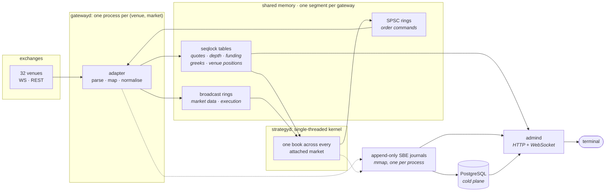

# raikiri documentation

How the framework is put together and how to work with it. The
[project README](../README.md) has the short version.

- [Architecture](#architecture): processes, channels, invariants
- [Running a gateway](#running-a-gateway): flags and credentials
- [Configuration](#configuration): venue rate limits
- [Venue table](#venue-table): column meanings, adding a venue
- [Performance](#performance): measured numbers
- [Build and test](#build-and-test): presets and sanitizers
- [Status](#status): what works and what is still open

## Architecture



Each gateway is one process for one venue and one market
(`gatewayd --venue=deribit --market=option`) and owns a shared-memory segment. A
single-threaded kernel polls every segment it is attached to, keeps one book across
them and sends orders back through the command rings. `persisterd` copies the journals
into Postgres; the trading path never waits on it.

| Channel                                         | Kind                            | Why                                                                                                 |
| :---------------------------------------------- | :------------------------------ | :-------------------------------------------------------------------------------------------------- |
| quotes, depth, funding, greeks, venue positions | seqlock table, overwrite-newest | only the latest value matters; a slow reader skips ahead                                            |
| market data, execution events                   | broadcast ring, gap-detecting   | a dropped fill would leave the book wrong, so an overrun is reported                                |
| order commands                                  | SPSC ring, lossless             | a cancel must arrive even under load                                                                |

<details>
<summary>Invariants the code relies on</summary>

<br>

- Money is fixed-point `int64`. Decision code avoids `double`, since a double round
  trip can move a price by a tick.
- A wire value that is not an exact multiple of the instrument's tick or lot size is
  treated as a schema change and is never rounded.
- "The venue cannot report", "the pull failed" and "the venue reported zero" are
  distinct states, so a failed position read is never taken as a flat position.
- The hot path uses `std::expected` and preallocated memory with no allocation in steady
  state. The cold path uses exceptions and coroutines for connection handling.
- Production runs on Linux x86-64. macOS works for development.

</details>

## Running a gateway

Public market data needs no credentials.

```sh
make deps && make build

# one venue, one symbol, twenty seconds of live market data
build/dev-asan/apps/gatewayd/gatewayd --venue=bybit --symbol=BTCUSDT --duration 20
```

When a gateway stops it prints the instruments it loaded and its BBO, depth, trade and
funding counts. If a venue renames a channel or stops publishing a stream, the count for
it is zero; unit tests against fixtures will not notice.

Credentials are passed as references (`env:NAME`, `file:/path`, `exec:command` or
`op://vault/item/field`) and never as values, since anything on the command line is
visible to every user on the host through `ps`.

```sh
gatewayd --venue=bybit --market=perp \
         --api-key=env:BYBIT_KEY --api-secret=op://trading/bybit/secret
```

## Configuration

`config/venues.yaml` sets each venue's rate limits. `RAIKIRI_CONFIG_DIR` names the
directory that holds it (default: `config` under the working directory). A venue that
is not listed, or has no `limits`, is not limited. Each entry under `limits` has these keys:

| key | meaning |
| :-- | :-- |
| `name` | label used in logs and metrics |
| `kind` | what is counted, default `rest`; see below |
| `window_ms` | sliding window length for `rest`, `ws_messages` and `ws_connects` |
| `max` | most allowed in any stretch of `window_ms`, or the count ceiling for the other kinds |
| `reserve` | part of `max` only order traffic may spend (`rest` only) |
| `match` | path prefixes the limit meters (`rest` only); omitted means every request |
| `scope` | `socket` or `ip`, for `ws_messages` only |
| `market` | `perp` or `spot`; omitted applies to both |

| kind | counts |
| :-- | :-- |
| `rest` | REST cost per window over the paths in `match` |
| `ws_messages` | outbound socket frames per window, per `scope` |
| `ws_connects` | connection attempts per window, per ip |
| `ws_streams` | subscriptions one socket may carry |
| `ws_sockets` | sockets one ip may hold |
| `ws_channels` | subscriptions across all sockets of the ip |
| `ws_frame` | subscriptions one subscribe frame may carry |

A REST request spends from every `rest` limit whose `match` prefixes its path, or from
none of them if any one would refuse. The limits are sliding windows, which also stay
within a venue that counts fixed windows, and are set at about 90% of the venue's figure.
`costs` lists `{ match, cost }` rules in the venue's own units: the longest match
wins, a `?k=v` in a rule must appear in the query, and an unmatched request costs
`default_cost` (1 unless set).

## Venue table

The table in the [project README](../README.md#venues) is generated from
[`libs/exec/src/caps.cpp`](../libs/exec/src/caps.cpp) by [`scripts/venue_table.py`](../scripts/venue_table.py).

| column | meaning |
| :-- | :-- |
| `custody` | CEX if the venue holds your coins, DEX if a contract does. The caps table has no bit for this, so the generator keeps its own list and refuses a venue missing from it. |
| `order entry` | *market data only*: the adapter sends no orders. Some of these venues sign orders with keys this codebase has no signer for: an EVM wallet on `aster` and `grvt` (EIP-712 on `grvt`), and a zk-rollup key on `lighter`. `cryptocom` uses a plain HMAC key, but its order path is not written yet. *no perp order API*: the venue publishes none, so trades there are placed by hand; `manual_only` in the caps row lists the markets. |
| `WS`, `FIX` | `WS`: the adapter sends create, cancel and amend over the venue's websocket trade API while that socket is logged in, and over REST otherwise. `FIX`: the venue offers FIX at some access tier; no adapter uses it yet. |
| `private stream` | how the account socket authenticates. `ListenKey` gets a token over REST and puts it in the URL; `AuthSubscribe` signs a frame on an open socket; `–` means there is no account socket, and fills arrive through the reconciliation pull. |
| `funding ledger` | the adapter reads the funding the venue actually charged from the account ledger. Without it, funding PnL is not tracked. |

<details>
<summary>Adding a venue</summary>

<br>

A market-data adapter is about 3,500 lines: catalogue, symbol map, book, envelope
dispatch, REST builder and websocket client. Order entry adds a signer, an execution
client and the reconciliation pulls.

Capture fixtures from the live venue first, into `tests/venues/<name>/fixtures` with a
README that names each file's endpoint and capture date. Write the parsers against
those bytes, then wire the client.

Register the venue in four places: `VenueId` in `libs/domain`, the caps row, the
factory, and `register_adapter()` in `apps/gatewayd/main.cpp`. Registration is explicit
because with static self-registration the linker can drop a venue from a static library
without a diagnostic.

</details>

## Performance

Measured on an Apple M-series laptop with a release build (`make bench`). Production
runs on Linux x86-64.

Shared-memory primitives, single operation, no contention:

| operation         |    time |
| :---------------- | ------: |
| seqlock read      | 0.68 ns |
| SPSC push + pop   | 1.71 ns |
| seqlock write     | 1.72 ns |
| broadcast publish | 2.14 ns |

Cross-process round trip, two processes, one SPSC ring each way, 200,000 round trips:

|       |    RTT | one way |
| :---- | -----: | ------: |
| p50   | 167 ns |   83 ns |
| p90   | 208 ns |  104 ns |
| p99   | 250 ns |  125 ns |
| p99.9 | 292 ns |  146 ns |

The maximum was 19.5 µs, from scheduler preemption; macOS cannot pin a thread to a
core. On Linux the benchmark pins with `--cpu A --cpu-child B`. The daemons do not pin
yet.

## Build and test

Requires CMake ≥ 3.28, Ninja, Conan 2 and a C++23 compiler (GCC 14, Clang 18 or
AppleClang 17).

```sh
make deps                  # dependencies via Conan
make test                  # ASan + UBSan
make test PRESET=dev-tsan  # ThreadSanitizer
make bench                 # Release benchmarks
```

## Status

Working today: market data on all 32 venues in the table, REST order entry on the 18 it
marks, the shared-memory transport, the SBE journals and their Postgres copy, and the
HTTP/WebSocket admin API in [`schema/admin-api.yaml`](../schema/admin-api.yaml).

Not every order path has run against a real account yet, and the caps table does not
record which have.

The API is not stable yet. A release that changes a shared-memory layout will say so.
